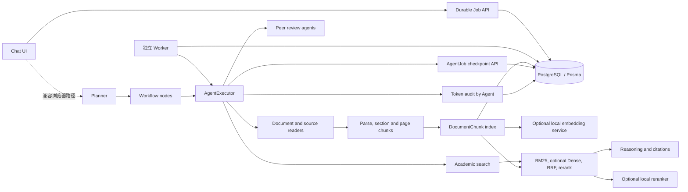

# ScholarKernel 架构说明

## 系统组成

ScholarKernel 是一个基于 Next.js App Router 的学术研究 Agent 原型。页面和交互状态由 React、Zustand 管理；Route Handler 承载会话、文档、设置、Agent Job、计费和代理接口。PostgreSQL 保存会话、文档、设置、Job 检查点和 Token 用量，Prisma SQL migration 是数据库结构的部署来源。

## Agent 执行流程

1. `src/lib/agent/planner.ts` 维护任务协议和节点类型。`AgentExecutor.plan()` 在 `src/lib/agent-executor.ts` 中调用当前模型生成计划，校验后把依赖关系整理为工作流节点。
2. `AgentExecutor.run()` 按节点依赖执行 `research`、`read_file`、`audit`、`reasoning` 或 `peer_review`。节点状态会同步到返回结果和 UI hooks；失败、部分完成和取消拥有不同的结果状态。
3. 研究节点调用 `src/lib/tools/search-tool.ts`，并对每批结果去重、统一来源编号。推理节点把检索来源和子任务结果放入当前提示词；来源信息不完整时不补造页码或引用。
4. 同行评审由 `src/lib/agent/peer-review-runner.ts` 执行。两位 Reviewer 可并行运行，各自完成后写检查点；之后进入 debate 和 Area Chair 汇总。满足人工干预条件时暂停等待决定，接受或重定向后继续。
5. 服务端 Job 路径由 `src/app/api/agent/jobs/route.ts` 创建并更新 Job 检查点；`src/app/api/agent/jobs/[id]/resume/route.ts` 从已保存节点和部分结果恢复可恢复状态。

普通聊天 UI 仍包含浏览器内的 `AgentExecutor` 执行路径；服务端 Job 路径提供持久化恢复能力，两条路径当前尚未完全统一。因此进程重启恢复的保证仅适用于走服务端 Job 的请求，不能据此声称所有浏览器内任务都可恢复。

## 文档解析与检索

- `src/lib/document/pdf-parser.ts` 使用 PDF.js 提取页面文字和几何位置，带文件大小限制、解析期限和 PDF.js 资源清理。
- `src/lib/document/column-reorder.ts` 只在存在坐标时进行栏顺序处理。只有纯文本而没有版面坐标时保留原有顺序。
- `src/lib/document/academic-semantic-chunker.ts` 按学术章节标题和段落切块，记录来源章节。页码仅从解析器观测到的页面块写入；无法映射时不赋默认页码。
- `src/lib/document/document-chunk-index.ts` 为保存文档写入稳定 `DocumentChunk` ID、章节、可选页码、内容 hash 和 parser version。可选 embedding 由显式配置的本地 HTTP 服务生成，向量和 revision 存在 PostgreSQL JSON 字段。
- `src/lib/document/search-conversation-chunks.ts` 以每页 256 行 keyset 分页扫描完整会话 chunk 集，分两遍计算全语料 BM25 统计/排序，并逐页计算可选 Dense cosine，再以 RRF 汇合和保留来源映射。没有固定 1,000 chunk 截断，也不使用 pgvector；Dense 和本地 reranker 都需显式配置，异常可降级。查询耗时仍随语料线性增长，容量仅验证至 5,000 个合成 chunk。
- `src/lib/tools/academic-search-strategy.ts` 负责搜索 query 扩写、来源合并、URL 去重和全局引用编号。
- `src/lib/document/rerank-gateway.ts` 支持显式本地或已有外部 Reranker；响应无效或服务不可用时回退到词项排序，并对中文使用字符 bigram。词项回退是规则排序。

独立研究工程 `../ScholarKernel-reranker` 实现可复现 BM25/Dense/RRF/预训练 Cross-Encoder 基线，并在 SciFact train/dev 上微调本地 Cross-Encoder。它不是应用默认模型，只有配置本地 endpoint 时才进入应用检索流程；模型权重不提交主仓库。

PDF.js 可以提取含文本层的 PDF。扫描版或只有页面图像的 PDF 需要 OCR，而项目目前没有 OCR；空白 PDF、密码保护、损坏或不受支持的文件会返回错误说明。

## 模型调用、预算和计费

模型调用通过 Vercel AI SDK 的 `generateText` 和 `streamText`，Provider 适配位于 `src/lib/agent/llm-utils.ts`。所有常规 Agent 生成使用 `inference.maxTokens` 作为输出 Token 上限；默认 1024，设置范围 1–8192。模型调用有超时、一个 SDK 重试机会和 AbortSignal 取消。

`inference.contextLimit` 以字符数截断提示词和历史，不是 tokenizer 计算的真实 Token 总数，也不包含所有 Provider 侧系统开销。流式正文只接收 `text-delta`；reasoning delta 不进入用户答案。流错误会作为失败返回，并保留已经输出的部分文本用于诊断。

模型返回的 `inputTokens` / `outputTokens` 按 `agentId` 写入 `TokenAuditLog`；计费展示依赖现有静态单价表估算，不是供应商账单。搜索结果条数不再伪装成模型 Token 用量。测试环境使用 Mock；没有真实供应商 API Key 时不验证真实模型调用。

## 数据库和环境

- Prisma schema：`prisma/schema.prisma`
- Migration：`prisma/migrations/`
- 本地开发：设置 `DATABASE_URL` / `DIRECT_URL` 后使用 `npm run db:migrate:dev`。
- CI 与部署：使用 `npm run db:migrate`（`prisma migrate deploy`），CI 对空数据库执行、重复执行并比较最终 schema。
- `UserBilling`、`TokenAuditLog` 与 Agent 用量字段均由 SQL migration 创建或扩展；生成客户端使用 `npx prisma generate`。

密钥配置参考根目录 `.env.example` 和 README。生产部署还需要单独检查实例密钥、代理配置、备份和供应商额度；本说明不是生产安全认证。

## 主要工程边界

- PDF 页面图像 OCR、图表理解、精确版面重建和自动评测语料不在当前实现中。
- `contextLimit` 不是硬性模型 Token 窗口限制；不同供应商的最大上下文、计费和重试行为仍可能不同。
- Durable Worker 可在 lease 过期且未超过最大 attempt 时重新认领任务；旧浏览器/兼容执行路径不具备同等的进程重启恢复保证。
- 普通 CI 使用 Mock 和本地服务；没有使用真实用户数据或真实模型 API。
- SciFact dev 有检索评测，但没有独立 test split，也不是用户上传文档或生成答案评测；Agent 单/多智能体对照没有执行。项目包含一个本地微调 Cross-Encoder 研究 checkpoint，但不代表生产模型或统计显著的普适提升。
