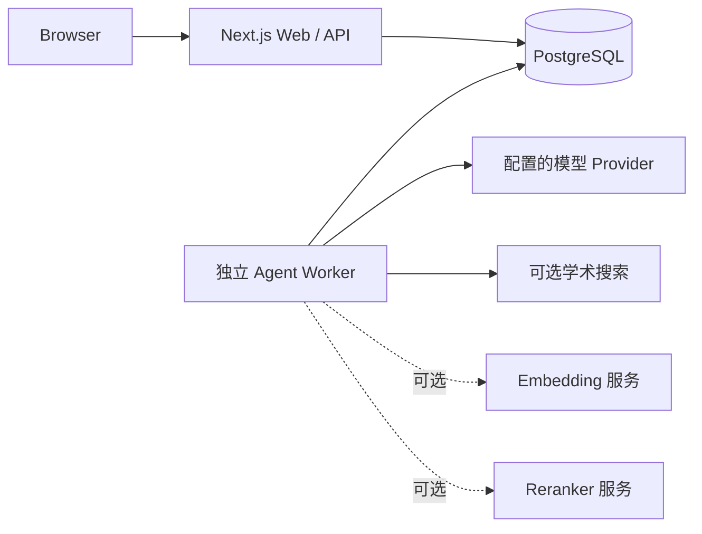

# Phase 5.1：远端 CI、迁移与部署验收

## 基线与远端状态

- GitHub `fix/phase1-foundations` 当前指向 `71bc1fe1dd65d906e892f05aaf2bdd5f194f5ca9`；本地该提交一致。本轮从该点建立 `fix/phase5-acceptance`。
- GitHub Actions API 对基线 SHA 返回 `total_count: 0`。GitHub 提交状态只有 `Vercel: success`，它不代表 GitHub Actions 已运行。没有发现关联 PR。
- 原 `.github/workflows/ci.yml` 只在 `main` push 或 PR 时运行；普通修复分支的 push 不会触发 CI。已将 `fix/**` push 纳入触发分支，并增加手动 `workflow_dispatch`。本地修改没有推送，故新触发器尚未在 GitHub 上运行。
- workflow 声明 Ubuntu 最新版、Node 20、PostgreSQL 16；执行锁文件安装、数据库迁移/重复迁移/schema diff、功能测试、Agent workflow、TypeScript、ESLint、Playwright Chromium 与 Next.js build。Dockerfile 使用 Node 22。两条运行路径使用的依赖锁文件相同；本轮没有声称远端容器镜像构建已执行。

## 隔离迁移验证

测试环境为本地新建 UTF-8 PostgreSQL 集群和新数据库 `scholar_upgrade`，监听 `127.0.0.1:55446`。没有连接开发、共享或生产数据库，没有删除或重置数据库。

实际运行：

1. `npx prisma migrate deploy`：从空库应用 10 条迁移，全部成功。
2. 再次运行 `npx prisma migrate deploy`：`No pending migrations to apply.`
3. `npx prisma migrate diff --from-config-datasource --to-schema prisma/schema.prisma --script --exit-code`：输出 `-- This is an empty migration.`，退出码 0。
4. 在该库执行 Agent Job 生命周期、文档索引、聊天 Worker/用量集成用例：14 项通过，覆盖 AgentJob / AgentJobEvent、恢复检查点、DocumentChunk、Embedding 模型与 revision 元数据、TokenAuditLog 正常读写。

## 部署拓扑

Docker Compose 默认只运行 PostgreSQL 和 Next.js；原配置没有启动 Agent Worker，因此 durable Job 在该部署方式下可能一直待处理。已加入 `durable-agent` profile 下的独立 Worker 服务。它复用应用镜像，等待数据库健康以及 Web 完成迁移并健康后启动。要启用 durable 模式，需在 `.env` 设置 `AGENT_DURABLE_JOBS=1` 和构建时变量 `NEXT_PUBLIC_AGENT_EXECUTION=server`，使用 `docker compose --profile durable-agent up --build -d`。

Web 与 Worker 都连接同一个 PostgreSQL。Worker 执行 `/api/agent/jobs` 创建的持久任务，并通过事件表供 SSE API 续读。实际部署时模型凭据需由服务端环境或加密的用户设置提供。可选 Embedding/Reranker 未被 Compose 管理；若将服务运行在宿主机，容器中不能把 `127.0.0.1` 当作宿主机地址，应改用网络可达的服务地址。

开发使用本机 PostgreSQL、Next.js dev server；Worker 用 `npm run worker` 单独启动。测试使用隔离 PostgreSQL、合成文档、Mock 或本地模型 HTTP 端点。生产拓扑需单独管理数据库、Web、一个或多个 Worker、模型服务与备份；本轮只做配置和本机验证，没有部署。

## 未执行与限制

- 未运行 GitHub Actions；基线没有 Actions run，远端只报告 Vercel 成功。
- 未运行完整 `npm run test:upgrade` 或整套 CI。该白名单包含 `boundaries.integration.test.ts`，本轮明确排除权限/安全验证；只运行普通 Job、文档索引和 Mock 聊天的隔离数据库集成用例。
- 未构建/启动 Docker 镜像，也未调用外部模型、部署或访问生产服务。Compose 配置将在后续本地语法检查中检查。
- PostgreSQL 的新测试集群和数据库保留在仓库 `node_modules/.cache/phase5-pg-utf8/` 与本机测试服务中；测试结束会停止服务，不删除数据目录。
