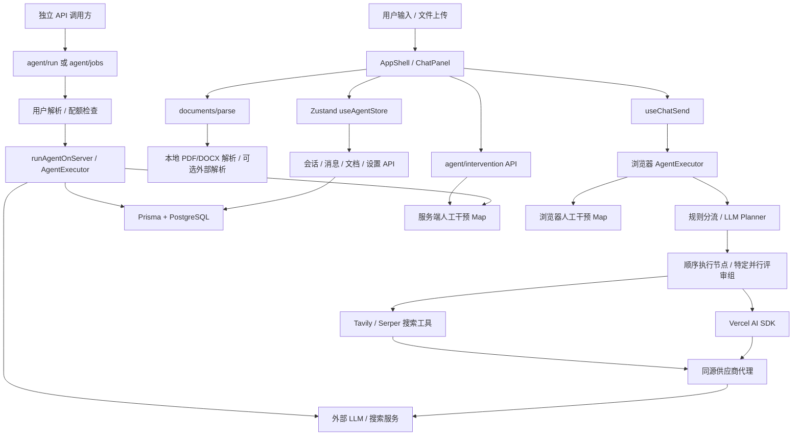
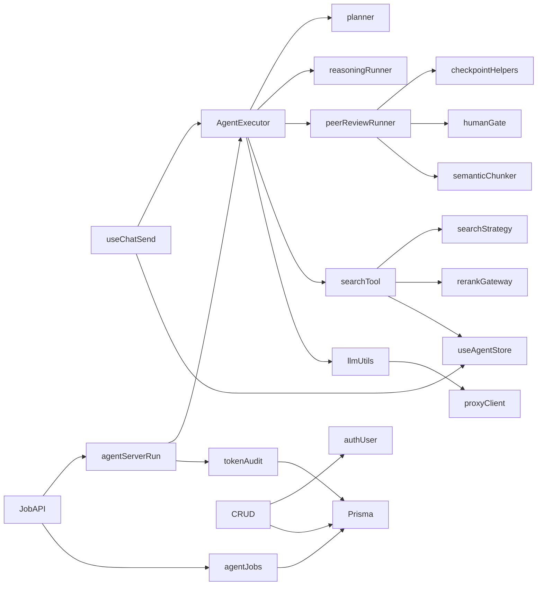

# ScholarKernel 系统架构分析

基线提交：`e129eb65e6bcbf6c2df9696c282613a557b672f1`。审计日期：2026-10-29。本文依据当前源码和已经完成的运行记录；不新增测试，不修改业务代码。

## 1. 实际架构

这是 Next.js 16.2.4 全栈应用，前端采用 React 19.2.4、TypeScript、Zustand 状态容器和 Tailwind CSS；服务端使用 App Router 路由处理器（Route Handler）、Auth.js 和 Prisma 7.8.0。数据库是 PostgreSQL，运行连接使用 `@prisma/adapter-pg`，连接池上限为 5。README、AGENTS 和部分测试规则中的 SQLite 描述已经过时。

最重要的架构事实：**主聊天界面在浏览器运行 AgentExecutor，服务端还存在另一套独立 Agent 执行 API。** 两套路径没有共享运行状态、人工干预等待表和完整计量数据。

图中浏览器 Gate 与服务端 Gate 没有连接，反映代码现实，不是设计建议。外部供应商能力未做真实效果验证。

## 2. 模块职责与依赖

- **页面与组件**：`src/app/page.tsx` → `AppShell` → `ChatPanel`、Sidebar、KeysPanel、ModelsPanel、SettingsPanel、DashboardPanel。主页面通过面板状态切换，非多个独立业务页面。`AcademicMarkdown` 显示聊天，TipTap 编辑文档，React Flow 显示拓扑。可视化边不等于执行器真正支持任意有向无环图（Directed Acyclic Graph，DAG）。
- **状态管理**：`src/store/useAgentStore.ts` 约 1,320 行，统一负责设置、模型、聊天、文档、拓扑、指标和同步动作。`persist` 只保存设置、provider 配置和 inference history，不保存 workflow/runtimeKeys。消息更新有 600 ms 防抖（Debounce），文档更新有定时同步；没有持久化任务队列或明确 flush/ack 协议。
- **规划器**：`src/lib/agent/planner.ts` 定义节点协议、正则意图识别、计划解析、容错及检索计划补齐；真正的 LLM 规划调用在 `agent-executor.ts:178`，不能只阅读 planner 文件判断全貌。
- **执行器**：`agent-executor.ts:576` 顺序遍历节点。read_file、research、audit、reasoning 分派各自实现，peer_review 连续组特殊处理；没有通用 dependsOn 字段、拓扑排序或独立工作队列。
- **推理与模型**：`agent/llm-utils.ts` 负责 SDK 模型构造、历史裁剪、流消费与用量桥；`direct-chat.ts` 和 `reasoning-runner.ts` 调用 streamText。`ai-gateway.ts` 另有连接检测和自定义流协议实现。两套网关职责重叠，需先统一行为契约，再决定是否合并。
- **检索与文档**：`tools/search-tool.ts` 调用网络搜索，`academic-search-strategy.ts` 扩展检索式、合并去重和上下文格式化；`document/rerank-gateway.ts` 提供重排接口。文档解析是独立入口，上传返回的 chunks/ragContext 没有完整作为检索索引保存。
- **服务端任务**：`agent-server-run.ts` 构造服务端依赖；`agent-jobs.ts` 写 Job/checkpoint/result。`jobs POST` 会等待整轮执行后返回，不是“提交即返回任务 ID”的后台任务队列。
- **认证与数据访问**：`src/auth.ts` 配置 Auth.js；`auth-user.ts` 解析用户及归属条件；middleware 保护部分路径，其他 API 依靠各自 handler。`session-auth.ts` 仍保留旧签名 Cookie 工具，但当前会话解析主要走 Auth.js，不能混称为统一会话协议。

`searchTool → useAgentStore` 是服务端与浏览器耦合点：服务端模块也会导入浏览器状态层。完整导入索引见 [import-graph.json](evidence/import-graph.json)。

## 3. 主要调用链

### 3.1 浏览器聊天

`ChatPanel → useChatSend.onSend → loadAgentExecutor → new AgentExecutor → run`。问候等少量短句由规则直接进入 `streamDirectChat`；普通知识问题仍通常调用 LLM 规划，再执行 reasoning。工具结果一部分作为子任务 JSON，一部分作为 assistant 历史传入后续模型。

生成过程通过 hooks 更新 Zustand，随后消息通过会话 API 防抖保存。这个路径没有调用 `/api/agent/jobs`，没有 Job ID，没有注入服务端 token recorder，也没有配额预检查。因此界面显示的计量与服务端账本并不覆盖同一执行集合。

### 3.2 服务端 Job

`POST /api/agent/jobs → resolveUserId → assertQuotaAvailable → createAgentJob → markRunning → runAgentOnServer → AgentExecutor.run → completeAgentJob`。

节点事件触发异步 checkpoint 写入；异常外抛才进入 failAgentJob。执行器内部已转成摘要的节点异常不再外抛。没有 worker、租约（Lease）、重启扫描、旧 Job 恢复入口或跨进程人工干预传输。GET Job 只查询结果。

### 3.3 模拟同行评审

`needsPeerReviewIntent → 三个角色节点 → Promise.all(R1,R2) → 人工批准等待 → 单次 debate → Area Chair 汇总`。实际依赖是固定模板，角色共享基础模型。其算法价值主要在任务拆分、并行与信息聚合，而非三个自主训练模型。详见 [Agent 分析](agent-evaluation.md)。

### 3.4 文献与引用

上传：`readBrowserFileAsText → documents/parse → parseLayoutAwareDocument → 重排版面 → 公式规则 → 章节切片`，前端最终只取 `data.text`。

检索：`research → query rewrite/expand → Tavily或Serper → 学术域名过滤 → rerank → 来源编号 → reasoning上下文 → Markdown引用`。没有在 schema 或源码中找到完整 Embedding、向量索引或自有语料 Dense Retrieval。不能将这一链路写成已实现向量数据库 RAG。

## 4. 数据与一致性

Prisma 模型包括 User/Account/Session/VerificationToken、Conversation/Message/Document、UserSetting、AgentJob、UserBilling/TokenAuditLog。会话、文档、消息存在级联关系；若配置登录，多数查询有 userId 约束。Document.version 采用先读再 +1，未做比较交换（Compare-and-Swap，CAS），并发编辑冲突没有明确协议。

消息与会话更新时间在事务内写入；计费使用事务和 increment，方向合理。但事务只保障数据库写入原子性，不自动保障对象授权、任务成功或外部模型调用的幂等性。检查点整块替换、异步未排队以及结束时覆盖快照使恢复不可靠。相关防御性整改事项见技术审计 F02、F04、F05、F13。

## 5. 部署与可观测性

Dockerfile 分 builder/runner，Node 22，非 root 用户，runner 复制完整 node_modules/.next/generated/prisma，启动执行 migrate deploy。Compose 提供 PostgreSQL 16、持久卷、数据库健康检查、应用内存限制和本机端口绑定。实际 Docker 守护进程不可用，因此**容器构建与启动未执行，环境受限**。

CI 使用 Node 20、PostgreSQL 16，执行 npm ci、db push、Vitest、lint、build；没有独立 tsc、迁移重建检查、浏览器流程 E2E 或 AI 效果门禁。当前本地 Node 22 / PostgreSQL 18 验证不能替代 CI 的版本矩阵。

日志主要为 console，Job 有 errorMessage/errorStack，节点有耗时，部分模型记录首 Token 时间（Time to First Token，TTFT）；尚缺端到端 Trace、统一 request/run ID、结构化失败分类和可靠计费落盘确认。健康接口只返回服务状态，不查询数据库；Compose 检查会话端点，也不能证明计费表或核心功能可用。

## 6. 建议的最小架构收敛

优先明确唯一权威运行状态：可以保留浏览器 UI 和流式展示，将可持久化执行、计费、人工干预放到服务端同一运行上下文。小规模先用单进程 + PostgreSQL 状态机即可；没有证据要求立即引入 Redis、Kubernetes 或通用 DAG 框架。按需求补幂等、顺序写、取消与恢复，再评估后台 worker。

安全相关接口边界只依据已有记录整理，**受安全策略限制，未进一步验证**。本轮没有进行新的漏洞复现或渗透测试。
