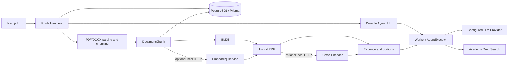

# ScholarKernel 2.0 架构摘要

## 当前系统

ScholarKernel 使用 Next.js App Router 提供界面和 API，React/Zustand 管理浏览器交互，Prisma/PostgreSQL 保存会话、文档、Agent Job 检查点与用量记录。模型调用仍由配置的 Provider 和 AI SDK 适配；本次没有调用真实外部模型 API。

## 组件边界

- **Agent**：Planner 生成受类型约束的节点计划，Executor 依依赖顺序执行；Job API/Worker 保存检查点、事件、取消与恢复状态。重试是至少一次，未提交 checkpoint 前的模型调用可能重复。客户端执行路径尚未完全迁移到 durable job。
- **文档**：PDF.js 提取文本和页面几何，Academic Chunker 写入章节、页码、稳定 ID 与内容 hash。只有可确认来源的页码才写入；没有文字层时当前无 OCR。
- **检索**：本地文档 chunk 先做 BM25；显式配置本地 embedding 时加 Dense cosine 和 RRF。JSON vector 存 PostgreSQL，尚未使用 pgvector。当前检索按 256 行 keyset 分页扫描全语料两遍，移除了每次最多读取 1,000 chunks 的旧上限；应用仍逐行计算 Dense，查询耗时随语料线性增长。可选 local/cross-encoder rerank 服务失败后回退可用检索顺序/词项排序。
- **研究工程**：同级 `../ScholarKernel-reranker` 是独立 Python/PyTorch repo，管理 SciFact 冻结数据、评测、训练与本机推理 API。它不是主应用默认依赖。checkpoint 文件不在 Git 中，hash 保存在训练结果与 Phase 4 报告。
- **预算与用量**：Agent 输出预算传给模型 SDK；输入 context 上限按字符裁剪而非 tokenizer 精确计数。用量依赖 Provider 返回值；展示成本为静态费率估算，不代表账单。

## 实验边界

已获得 SciFact dev evidence retrieval 的可复现指标。实验不测生成回答、claim 真伪、用户文档、中文检索或 Agent 多智能体收益；dev split 用于 epoch 选择，没有未触碰 test 结果。模型集成验证在 loopback 服务和隔离 PostgreSQL 合成文档上执行。

## 相关文档

- [Phase 0：数据边界](phase0-boundaries.md)
- [Phase 1：服务端 Job](phase1-jobs.md)
- [Phase 2：Academic RAG](phase2-rag.md)
- [Phase 3：检索评测](phase3-evaluation.md)
- [Phase 4：Reranker 研究](phase4-reranker.md)
- [测试与验证记录](TEST_RESULTS.md)
